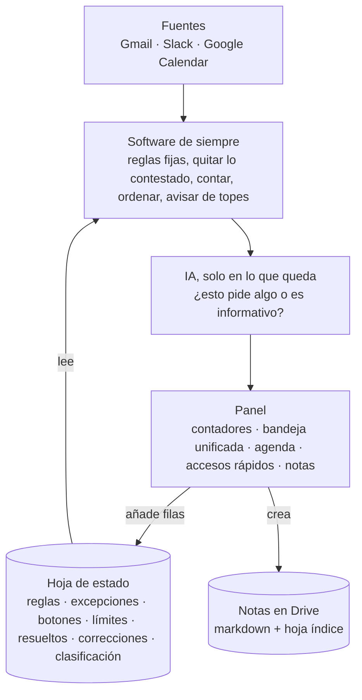

# Cómo funciona

Lo que hace el panel en cada carga, cómo decide el estado de cada elemento, qué hace la IA y qué no, y por qué está montado así.

## Principio de diseño

La IA entra solo en cuatro pasos: clasificar, buscar contexto, proponer respuesta y esquematizar una nota. Hoy solo está construido el primero. Todo lo demás es software de siempre: leer, cruzar, contar, filtrar, ordenar. Lo que se puede decidir con una regla no se le pregunta a un modelo.

## En cada carga

1. Lee la hoja de estado: reglas, excepciones, accesos rápidos, límites y lo que ya se ha resuelto, corregido o clasificado.
2. **Gmail**: bandeja y enviados de los últimos 3 días, cruzados por hilo. Los hilos que llegan incompletos se abren enteros (hasta 10).
3. **Slack**: mensajes directos (se lee cada conversación, hasta 15) y menciones (se agrupan por hilo y se lee cada hilo, hasta 15). Además, mis directos enviados y los perfiles, para unir a cada persona con su correo.
4. **Calendar**: eventos de hoy, solo reuniones con otras personas.
5. Aplica reglas, correcciones, IA, resueltos y leídos (abajo), y pinta los contadores, la bandeja con filtros, la agenda, los accesos rápidos y las notas.
6. Si está configurado, lee el resumen del panel de salud y pinta su botón en la cabecera.

Cada bloque se pinta cuando llega su fuente. Si una falla, sale su aviso y su botón de reintentar, y el resto sigue. Cuando un límite corta, el panel dice cuánto ha leído y si puede haber más. Los datos valen 5 minutos: «Actualizar» los vuelve a pedir y, al volver a la pestaña, se releen si han caducado.

## Cuándo algo está contestado

- **Correo**: mi último mensaje del hilo es igual o posterior al último recibido.
- **Slack, mensaje directo**: el último mensaje de la conversación es mío.
- **Mención en un canal**: se lee el hilo. Si después de la mención el último mensaje humano es mío, «Contestado en el hilo». Si es de otra persona que no es quien preguntó, «Atendido por…». Si es de quien preguntó, sigue pendiente.
- **Entre canales**: si alguien me escribe por correo y le contesto por Slack, o al revés, se une por persona. Si mi último mensaje a esa persona por el otro canal es posterior al suyo, pasa a «Contestado por Slack» o «Contestado por correo».

## El estado de cada elemento, en este orden

1. **Regla** de la hoja, salvo que la coja una excepción: pasa a Informativos, agrupado por el nombre de la regla, o a «Para leer» si la regla tiene `destino` = `leer`.
2. **Corrección a mano** («Informativo», «Para leer» o «Necesita respuesta»): manda hasta que llega un mensaje posterior, y bloquea a la IA.
3. **IA**: solo si no hay corrección. Solo cambia algo cuando dice «informativo»; entonces el elemento pasa al grupo «Apartados por la IA» con su motivo.
4. **Cruce entre canales**, como arriba.
5. **Resuelto a mano**, con motivo: sale de pendientes hasta que llega un mensaje posterior. Sirve para lo que se cerró por teléfono o en persona.
6. **Leído**: lo de «Para leer» pasa a Informativos, grupo «Leídos», hasta que llega un mensaje posterior. «No leído» lo devuelve antes.

Lo informativo nunca desaparece sin rastro: se aparta, se cuenta y se puede ver. Lo automático a veces pide acción. Los grupos de Informativos se pliegan; arrancan plegados salvo «Marcados a mano» y «Apartados por la IA».

## «Para leer»

Son avisos que no piden respuesta pero que hay que leer. Tienen su contador y su filtro, y no cuentan en «Pendiente» ni en «Esperan respuesta». Entran por una regla con `destino` = `leer` o a mano, con el botón «Para leer»: solo ese mensaje, o todos los de ese remitente, que crea la regla. La IA no los ve ni propone esta categoría.

## El botón de salud

Lee la pestaña `Resumen` de la hoja de un panel de salud de automatizaciones (columnas proyecto, estado, detalle, timestamp) y no recalcula nada. Rojo si algún estado no es OK; ámbar si el detalle lleva «⚠» o el último latido tiene más de 26 horas; verde si todo va bien; gris si no se puede leer. Al pulsarlo, abre el panel de salud.

## La IA

- Clasifica al terminar cada carga, y solo lo pendiente que todavía no ha visto. Va en tandas de `ia_lote` mensajes, hasta `ia_lotes` tandas. Con `ia_lotes` a 0 queda apagada.
- Usa el modelo rápido. Recibe remitente, asunto y los primeros 500 caracteres de cada mensaje.
- No tiene herramientas: recibe datos y devuelve texto. No puede escribir, enviar ni borrar nada.
- Los mensajes le llegan entre marcadores, con la orden de no seguir ninguna instrucción escrita dentro. Su respuesta se valida: número, categoría y un motivo recortado.
- Ante la duda, deja el elemento pendiente. Es peor ocultar algo que pide acción que dejar algo de más.
- Lo que clasifica se guarda en la pestaña `clasificacion`, para no volver a pagarlo.
- Las 12 últimas correcciones a mano van como ejemplos en cada tanda: corregir enseña.
- Los escalados del bot de soporte no pasan por la IA: siempre piden atención.

## Notas

- Cada nota es un archivo markdown en una carpeta de Drive, con el nombre `concepto - AAAA.MM.DD - contexto`. Si ya existe, se añade (2), (3). Nunca se sobrescribe.
- Cada nota tiene su fila en la hoja índice. Si el archivo y la hoja no coinciden, manda el archivo.
- Editar o cerrar una nota desde el panel crea la versión nueva con el mismo nombre y mueve la anterior a la subcarpeta `_anteriores`. El conector de Drive no puede reescribir el contenido de un archivo, así que no se borra nada.
- Una nota se puede crear desde un correo: el cuerpo se trae en texto plano y se limpia de citas y textos legales.
- No se abren en el navegador de Drive: se convertirían en documento de Google.

## Seguridad

- Todo el texto de terceros se pinta como texto, nunca como HTML. El markdown de las notas pasa por un renderizador propio que tampoco usa HTML.
- Los enlaces que salen de los mensajes solo llevan a Gmail, Slack, Drive, Docs, Calendar, Google Forms y Looker Studio. Los accesos rápidos admiten cualquier `https`, porque los escribo yo en la hoja.
- Las celdas que empiezan por `=`, `+`, `-` o `@` se escriben con un apóstrofo delante, para que la hoja no las ejecute como fórmula.
- Nada se envía desde el panel, y no hay ninguna clave ni token dentro.

## Decisiones cerradas

| Idea | Por qué no |
| --- | --- |
| Enviar respuestas desde el panel | Lo irreversible lo pulso yo. Cuando llegue, será siempre borrador |
| Recordar correcciones o resueltos en el navegador | No se comparte entre equipos ni lo puede leer otro flujo. Va a la hoja |
| Leer canales de Slack enteros | Mucho ruido; menciones y directos cubren lo que espera algo de mí |
| Notas dentro del artifact | La app se rehace en minutos; lo guardado en una plataforma, no. Lo aprendí al cambiar de herramienta y perder lo que vivía dentro |
| Notas como filas de una hoja | Una nota larga en una celda no se lee ni se edita |
| Notas en un canal propio de Slack | Se encuentran buscando, pero sin estructura ni nombre |
| Descartar los informativos sin dejar rastro | Lo automático a veces pide acción: se apartan, se cuentan y se ven |
| Webhook de Apps Script para escribir | No hace falta: el artifact escribe en Drive y en hojas con los conectores |
| Chips de Google en los accesos rápidos | La lectura de la hoja solo devuelve el texto visible: el enlace va como texto |
| Clasificar con IA todo en cada carga | Se paga cada vez: solo lo nuevo, y el resultado se guarda |
| Meter «Para leer» dentro de Pendiente | Lo que pide respuesta y lo que pide lectura no se atienden igual. Lo leído va a Informativos, no a Resueltos |
| Recordar en el navegador qué grupos están plegados | Igual en cualquier equipo |
